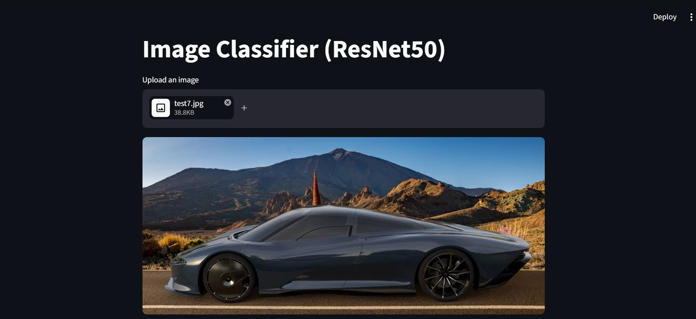
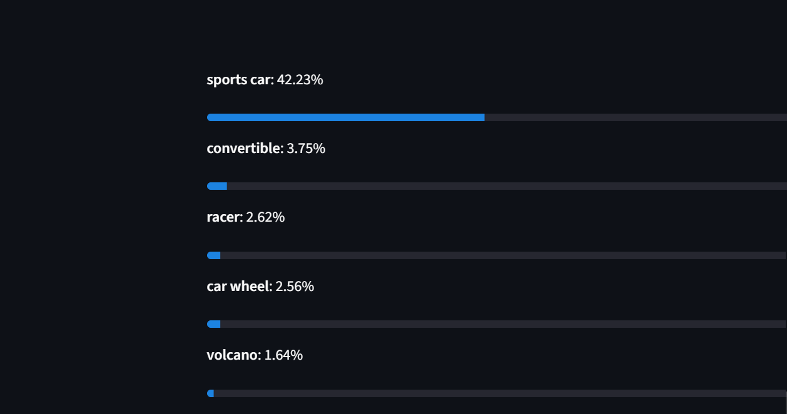

# Image Classification Using a Pretrained Model

Classifies images into 1000 ImageNet categories using a pretrained ResNet50 model (PyTorch). No training is needed, because the model already learned from 1.2 million images.

## Features
- Command-line classifier that shows the top-5 predictions
- Streamlit web app where you can upload an image and see predictions

## Tech Used
Python, PyTorch, torchvision, Pillow, Streamlit

## Setup
```bash
python -m venv venv
venv\Scripts\activate
pip install -r requirements.txt
```

## Run
Command line:
```bash
python classify.py test.jpg
```

Web app:
```bash
streamlit run app.py
```

## How It Works
1. Load ResNet50 with pretrained ImageNet weights.
2. Preprocess the image (resize, center-crop to 224x224, normalize).
3. Run inference and apply softmax to get probabilities.
4. Display the top-5 predicted classes.

## Results
| Image | Prediction | Confidence |
|---|---|---|
| Dog | golden retriever | 20.81% |
| Banana | banana | 67.27% |
| Pizza | pizza | 40.51% |
| Car | sports car | 42.23% | 




## Limitations
Cartoon and illustration images give low-confidence results, because the model was trained on real photographs. The model also has no "person" class, so images of people give unreliable predictions.

## Future Improvements
- Compare ResNet50 with MobileNet and EfficientNet
- Fine-tune on a custom dataset
